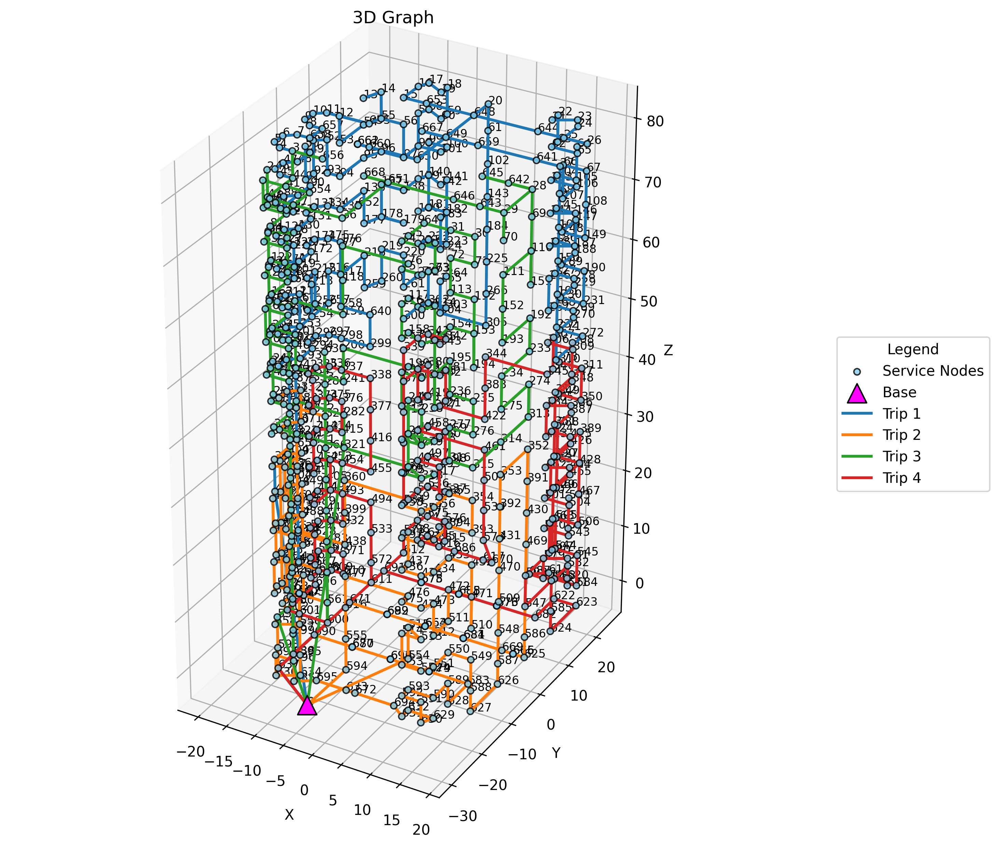

# Drone Route Optimization 🚁

Mathematical modeling and path planning project that calculates the optimal 3D routes for a fleet of drones. It minimizes flight energy consumption and total travel time across complex building structures. The problem is solved through Mixed-Integer Linear Programming

## Key Features
- **Spatial Clustering**: Groups target service nodes logically within buildings using K-Means algorithm.
- **Advanced Graph Pathfinding**: Validates drone traversals generating valid adjacency matrices (bases, edges, entry points) via Euclidean distances.
- **MILP Optimization**: Solves the MILP Single Commodity Flow problem using the CBC solver.
- **3D Visualization**: Renders generated flight tours in a fully interactive 3-dimensional plot.

## Project Structure
```text
.
├── data/                  # Input datasets (i.e., node 3D coordinates)
│   ├── building_1.csv     
│   └── building_2.csv     
├── docs/                  # Technical documentation and mathematical formulations
│   └── model.tex          
├── notebooks/             # Jupyter notebooks for data exploration and PoCs
│   └── big_project.ipynb  
├── src/                   # Main source code
│   └── main.py            # Entry point for the MILP and K-Means algorithms
├── requirements.txt       # Core dependencies
└── .gitignore             # Ignored files (LaTeX, IDE, environments)
```

## Installation
Clone the repository and install the required dependencies. Usage of a virtual environment is strongly recommended:

```bash
# 1. Set up a virtual environment
python -m venv .venv
source .venv/bin/activate   # On MacOS/Linux
# .venv\Scripts\activate    # On Windows

# 2. Install dependencies
pip install -r requirements.txt
```

## Usage
Run the main algorithm by passing the target building dataset as a command-line argument:

```bash
# Calculate routes for Building 1
python src/main.py building_1.csv

# Calculate routes for Building 2
python src/main.py building_2.csv
```

## Example / Output
During execution, the script logs the optimization status and prints the generated travel paths in the console:
```text
Processing building_1.csv
Running MIP optimizer...
Trip 1: 0-14-11-8-0
Trip 2: 0-7-9-0
```
Upon completion, a 3D visualization using `matplotlib` automatically pops up showing the drone bases, service nodes, and optimized flight trajectories.



## Tech Stack
- **Language**: Python 3
- **Data & Math**: `pandas`, `numpy`, `scipy`
- **Graphs**: `networkx`
- **Optimization**: `mip` (Python-MIP)
- **Visualization**: `matplotlib`

## Author
**Michele De Matteo**

**Davis Crippa**

**Andrea Compagnoni**


